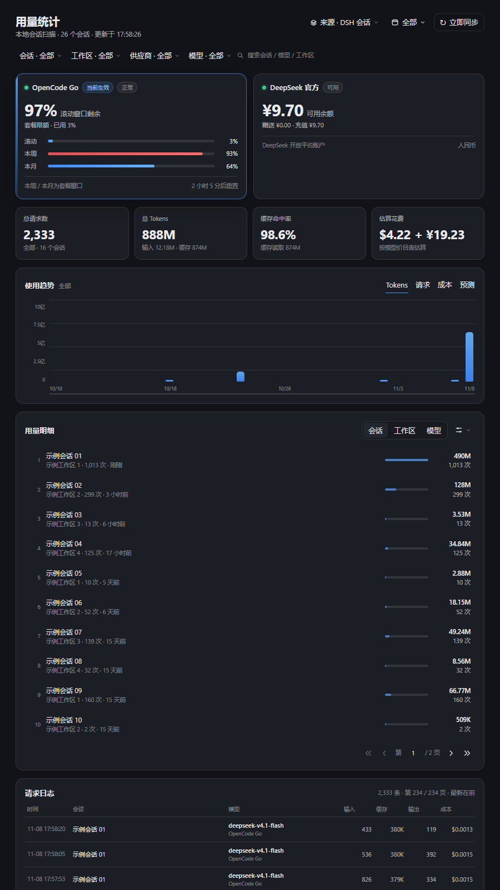
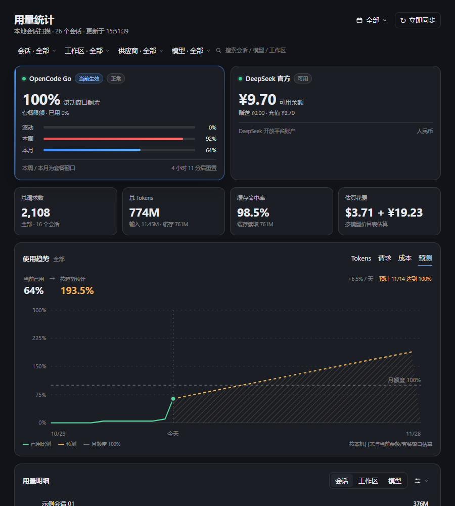
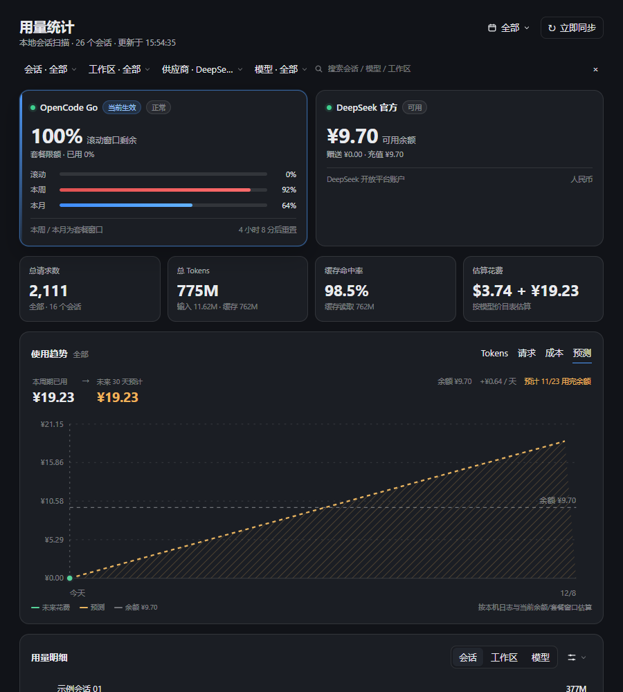
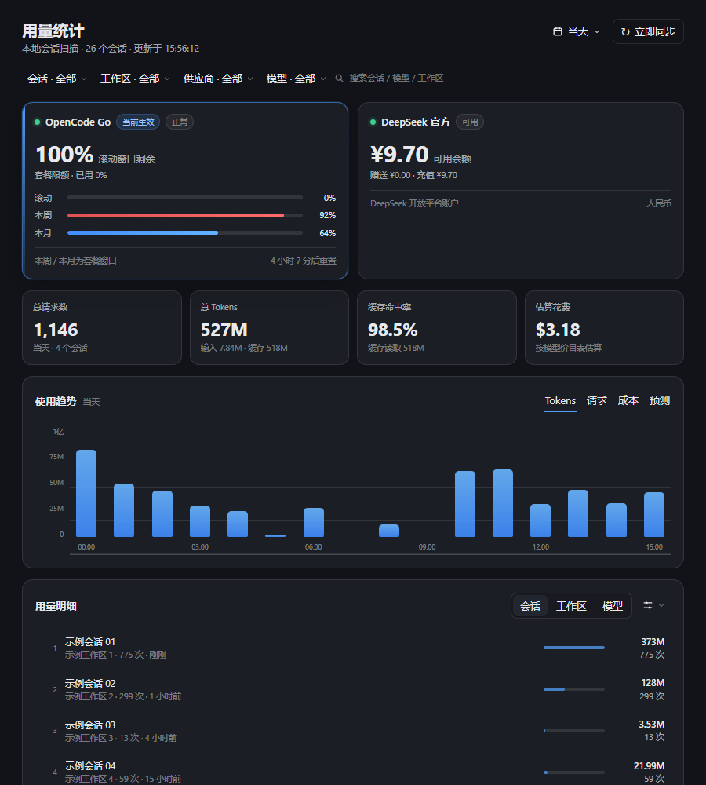
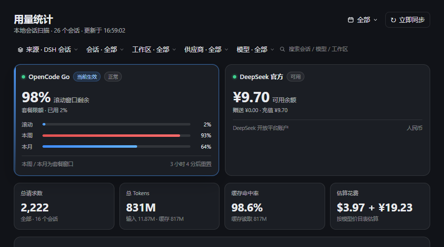

# 用量罗盘 · dsh-usage-compass

**DeepSeek Harness（DSH）设置页插件：本机 API 用量、余额，以及带趋势预测的用量看板。**

支持 **OpenCode Go** 订阅和 **DeepSeek 官方** API。所有统计都来自本机会话日志，Key 与余额请求只发生在 DSH 宿主进程里，不进入浏览器。



## 为什么叫“罗盘”

大多数用量面板只回答“已经花了多少”。用量罗盘还回答：

- 按现在的速度，月底会到 **多少百分比**？
- 订阅什么时候会撞到 **100% 月额度**？
- DeepSeek 余额按当前速度还能用 **几天**？
- 今天是几点到几点在消耗？近 24 小时跨天时，哪一段属于昨天？

## 功能

- **余额卡片**：OpenCode Go 滚动 / 本周 / 本月三个窗口；DeepSeek 官方赠送、充值、可用余额。
- **用量总览**：请求数、输入 / 缓存读取 / 缓存写入 / 输出 Tokens、缓存命中率。
- **趋势**：`Tokens / 请求 / 成本 / 预测` 四个视图。
  - 当天按小时节点展示，近 24 小时跨天时标签带日期。
  - 7 / 14 / 30 天 / 全部按自然日。
  - 纵轴 5 档插值，自动使用“亿 / M / K”。
- **预测**：固定在 `成本` 右侧。
  - 订阅：按当前套餐窗口的月度百分比趋势，预测到重置日会到多少，给出预计达到 100% 的日期。
  - DeepSeek 官方：按固定最近 30 天的日均，预测未来 30 天花费；虚线是**当前余额**，余额刷新会自动移动。
  - 悬停有垂直辅助线、底部日期游标、圆点和数值 tooltip。
- **花费估算**：OpenCode Go 按内置美元价目表；DeepSeek 官方按内置人民币峰谷价目表。不是“订阅制不计费”。
- **明细排行**：会话 / 工作区 / 模型，默认活跃优先，可切用量优先；每页 10 条。
- **精细筛选**：会话、工作区、供应商、模型文字下拉；会话 / 模型 / 工作区搜索。
- **自定义来源**：右上角、日期范围左侧的「来源」可勾选 DSH 会话与外部插件推送；默认只勾选 DSH 会话，其它来源显式开启后才计入。
- **横向滚动**：筛选条超出宽度时，滚轮可横向循环滚动，不再挤压、换行或被页面纵向滚动抢走。
- **请求日志**：每页 10 条，默认最新页，底部页码输入跳转。
- **时间范围**：当天 / 近 24 小时 / 近 7 天 / 近 14 天 / 近 30 天 / 全部 / 自定义月历。

### 预测视图



### DeepSeek 官方余额预测



### 当天小时节点



## 自定义来源与审计接入

默认只勾选 **DSH 会话**。顶部 `来源` 菜单里的其它来源默认关闭，勾选后才进入总请求数、Tokens、成本、趋势、排行和请求日志。



### 入口 1：DSH 插件宿主服务（推荐）

同一 DSH 进程内的插件直接取服务，不经过 HTTP，也不需要知道端口：

```js
const audit = ctx.get('usageAudit')
if (audit !== undefined) {
  await audit.ingest({
    source: { id: 'ai-review', label: 'AI 审核插件', kind: 'plugin' },
    events: [{
      time: Date.now(),
      provider: 'deepseek-official',
      model: 'deepseek-v4.1-flash',
      input: 1200,       // 未命中缓存的输入
      cacheRead: 3000,   // 命中缓存的输入
      cacheWrite: 0,
      output: 300,
      cost: 0.0021,      // 可选；省略则按内置价目表估算
      currency: 'CNY',
      sessionId: 'review-2026-11-08',
      title: '命令审核',
      workspace: 'L:/work/project',
    }],
  })
}
```

`ctx.get('usageAudit')` 不需要把 `usageAudit` 加进 `inject`；来源插件不可用时返回 `undefined`，审计调用可以安全跳过。

### 入口 2：本地 HTTP

适合 MCP bridge、脚本或不在 DSH 进程内的助手：

```http
POST http://127.0.0.1:<DSH Web 端口>/plugins/dsh-usage-statistics/ingest
Content-Type: application/json
X-Usage-Token: <可选，配置了 ingestToken 时必填>

{
  "source": { "id": "ai-review", "label": "AI 审核插件", "kind": "plugin" },
  "events": [
    {
      "time": 1794123136000,
      "provider": "deepseek-official",
      "model": "deepseek-v4.1-flash",
      "input": 1200,
      "cacheRead": 3000,
      "output": 300,
      "cost": 0.0021,
      "currency": "CNY",
      "sessionId": "review-2026-11-08",
      "title": "命令审核"
    }
  ]
}
```

响应：

```json
{ "ok": true, "accepted": 1, "duplicates": 0, "rejected": 0, "sources": [...] }
```

- 每次最多 100 条；超过 1 MB 的请求体拒绝。
- `source.id` 必须匹配 `[a-z0-9][a-z0-9._-]{0,63}`；`dsh-session` 保留给内置来源。
- 同一事件重复提交会按 `id` 或内容哈希去重。
- 事件写入 `~/.dsh/storages/dsh-usage-compass/events.jsonl`；DSH 会话不会写入这个文件。
- 不传 `cost` 时按插件价目表估算；传 `cost` 时以调用方账单为准。

### 入口 3：来源清单

```http
GET /plugins/dsh-usage-statistics/sources
```

返回已注册来源、事件数和存储路径，便于脚本确认接入是否成功。

### 字段口径

| 字段 | 含义 |
|---|---|
| `input` | 未命中缓存的输入 Tokens；不要传包含缓存命中的总 prompt tokens |
| `cacheRead` | 命中缓存的输入 Tokens |
| `cacheWrite` | 缓存写入 Tokens |
| `output` | 输出 Tokens |
| `reasoning` | 可选，推理 Tokens |
| `cost` / `currency` | 可选账单金额与币种；`CNY` / `USD` |
| `sessionId` | 可选；同一来源同一 session 会聚合成一条排行 |
| `workspace` | 可选；用于工作区筛选 |
| `provider` / `model` | 用于供应商 / 模型筛选和价目表估算 |

### 关于“直接监控”

插件没有全局网络钩子，也没有权限读取其它插件的 API 响应。直接拦截其它插件的模型请求既不可靠，也会越过插件边界；因此这里采用 **主动推送 + 本地持久化**：AI 审核插件在拿到 `usage` 后调用一次入口即可。若某个工具只能写日志，后续可以再加“文件 tail 来源”，但当前不伪装成能自动监控任意进程。

## 安装

### 方式 A：从插件市场索引安装（推荐）

DSH 目前（0.2.1-rc.5）**没有官方公共插件市场**：Plugins 页的 Discover 只读取用户自己添加的 market index。因此本项目自带一个单插件索引，添加一次后就能在 Discover 里搜索到。

1. 打开 **Plugins → More（Experimental plugins）**，启用 **Custom plugin markets**。
2. 在 **Discover** 的索引里添加：

```text
https://raw.githubusercontent.com/CHengShan-deep/dsh-usage-compass/main/market/index.json
```

3. 搜索 **用量罗盘**、**Usage Compass**、**usage forecast** 或 **预测**。
4. 安装后重启 DSH（或刷新页面，取决于当前热重载组合）。

> 这是自定义索引，不是 DSH 官方内置市场。只有添加了该索引的用户才能搜到。若 DSH 后续开放官方索引，可以把 `market/index.json` 里的条目直接提交过去。

### 方式 B：本地插件目录

```sh
mkdir -p ~/.dsh/profiles/desktop/local-plugins
cp -r dsh-usage-compass ~/.dsh/profiles/desktop/local-plugins/
```

在 `~/.dsh/profiles/desktop/cordis.patch.yml` 末尾追加：

```yaml
- insert:
    - id: usage-statistics
      name: './local-plugins/dsh-usage-compass/src/index.js'
      config:
        refreshSeconds: 5
        balanceSeconds: 30
        requestsLimit: 5000
```

### 方式 C：从 Git 安装

```sh
dsh plugin --profile desktop add git+https://github.com/CHengShan-deep/dsh-usage-compass.git
```

重启 DSH 后，设置左侧会出现「用量统计」。

> 从旧版 `dsh-usage-statistics` 升级：先移除 `local-plugins/dsh-usage-statistics` 和 `cordis.patch.yml` 里的旧 `usage-statistics` 条目，再安装本包，避免同一个插件 id 重复注册。

## 配置（可选）

`apply(ctx, config)` 支持：

| 键 | 默认 | 含义 |
|---|---|---|
| `refreshSeconds` | `5` | 用量聚合缓存秒数；`?force=1` 绕过 |
| `balanceSeconds` | `30` | 余额查询缓存秒数 |
| `requestsLimit` | `5000` | 返回给页面的请求条数上限（客户端每页 10 条） |
| `pricing` | `{}` | 覆盖单个模型的每百万 Token 单价 |
| `ingestToken` | `''` | 非空时，外部 HTTP 推送必须带 `X-Usage-Token` |

OpenCode Go 与 DeepSeek 官方都已内置价目表。`pricing` 只用于覆盖，或给其它供应商补单价：

```yaml
config:
  pricing:
    my-model:
      input: 2
      cacheRead: 0.2
      cacheWrite: 0
      output: 4
      currency: CNY
```

DeepSeek 官方内置价（元 / 百万 Token，空闲 / 高峰）：

| 模型 | 缓存命中 | 缓存未命中输入 | 输出 |
|---|---:|---:|---:|
| DeepSeek V4.1 Flash | 0.02 / 0.04 | 1 / 2 | 4 / 8 |
| DeepSeek V4 Pro | 0.15 / 0.30 | 4.5 / 9 | 13.5 / 27 |

空闲时段为北京时间 00:30–08:30。OpenCode Go 的 DeepSeek V4 模型按 UTC 峰时（周一至周五 01:00–04:00、06:00–10:00）切换；其它模型按上下文长度分档。

## 数据口径

数据来自 `~/.dsh/sessions` 下的会话日志：

- `assistant/chunk` 的流式 usage
- `assistant/message` 的最终 usage
- 按 `turn/step` 去重，最终 usage 覆盖同一步的流式值
- 没有 usage 的旧日志用 DSH `session_projcache` 兜底
- 每个日志按文件 mtime + size 增量缓存，只重扫变化的会话

Tokens = 未命中缓存输入 + 缓存读取 + 缓存写入 + 输出。缓存命中率 = 缓存读取 /（输入 + 缓存读取 + 缓存写入）。

## 余额来源

| 来源 | 凭据引用 | 接口 |
|---|---|---|
| OpenCode Go | `OPENCODE_GO_API_KEY`（兼容 `OPENCODE_API_KEY`） | `GET https://opencode.ai/zen/go/v1/usage` |
| DeepSeek 官方 | `DEEPSEEK_API_KEY` | `GET https://api.deepseek.com/user/balance` |

解析顺序：`ctx.credentials.resolve()` → 启动环境 → 进程环境变量。浏览器只请求插件自己的 `/plugins/dsh-usage-statistics/data`。

「当前生效」取自 `agentDefaultModel.currentSelection()`；服务不存在时，回退到最近有请求的会话使用的 provider/model。`deepseek-account` OAuth 登录没有可用的 API Key 余额接口，会提示到平台查看。

## 安全边界

- 不把任何 API Key 发给浏览器
- 只读本地会话日志与 DSH 凭据存储
- 余额接口只由宿主进程访问
- 插件路由只监听回环地址，并校验 `Origin` / `Referer`

## 开发

```sh
node tests/host.test.mjs
node tests/client.test.mjs
node -e "JSON.parse(require('fs').readFileSync('market/index.json','utf8'))"
```

测试覆盖：会话解析、去重、聚合口径、Go / DeepSeek 峰谷价、筛选排序、自定义时段、搜索、小时分桶、zstd 多帧解码、HTTP handler、客户端渲染、双分页、预测视图、官方余额虚线。

## 已知限制

- OpenCode Go 的 `/usage` 接口未公开文档化，字段变化时会显示「读取失败」，不会崩溃。
- 账号 `/usage` 百分比包含其它客户端/设备，可能与本机估算花费不一致。
- 只统计本机 `~/.dsh/sessions`，不汇总其它机器或 CC-Switch 历史。
- 预测是线性趋势估算，不是账单承诺。
- 未配置 `pricing` 的其它供应商不计入估算花费；成本卡 tooltip 会显示已计价条数。
- 余额请求需要网络；离线时显示上次缓存/错误，不影响本地统计。

## License

MIT
